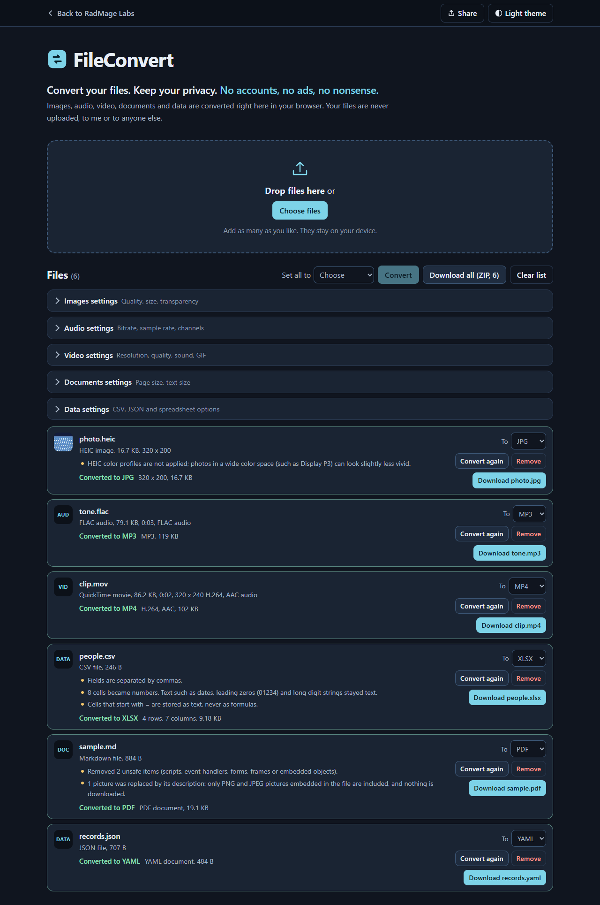

# FileConvert

**Convert files. Upload nothing. No accounts, no ads, no nonsense.**

FileConvert is a free file converter for images, audio, video, documents and data that runs entirely in your browser. Your files are never uploaded, to me or to anyone else: every conversion happens on your own device.

**Use it at [radmagelabs.com/fileconvert](https://radmagelabs.com/fileconvert/).**

Current version: **v0.1.2**



## What it converts

| From | To |
|---|---|
| **Images:** JPG, PNG, WebP, AVIF, HEIC/HEIF, BMP, GIF, TIFF (every page), ICO/CUR, SVG | JPG, PNG, WebP, AVIF, GIF, BMP, TIFF (one page or multi-page), ICO |
| Animated GIF, WebP and PNG (APNG) | Animated GIF, animated WebP, MP4, WebM |
| **Audio:** MP3, WAV, FLAC, AAC, M4A, OGG (Vorbis or Opus), AIFF/AIFF-C | MP3, WAV, FLAC, AAC, M4A, OGG (Opus) |
| **Video:** MP4, WebM, MOV, MKV, MPEG-TS (.ts, .mts, .m2ts) | MP4, WebM, MOV, MKV, GIF, or any audio format above (the soundtrack) |
| **Documents:** TXT | PDF |
| PDF | TXT |
| Markdown | HTML, PDF, DOCX |
| HTML | PDF, Markdown, DOCX |
| DOCX | TXT, HTML, Markdown |
| **Data:** JSON | CSV, TSV, XLSX, JSON Lines, YAML, XML |
| JSON Lines | JSON, CSV, TSV, XLSX |
| CSV | JSON, TSV, XLSX, JSON Lines |
| TSV | JSON, CSV, XLSX, JSON Lines |
| YAML | JSON, CSV, TSV, XLSX |
| XML | JSON, CSV, TSV, XLSX |
| XLSX | CSV, TSV, JSON, JSON Lines |
| XLS, ODS | XLSX, CSV, TSV, JSON, JSON Lines |
| **Archives:** ZIP, TAR, GZ (.tar.gz, .tgz) | Unpacked, not converted: download the files inside, or convert them |

Every pair in this table is tested in the browser. Results are checked by reading them with independent programs (Pillow, FFmpeg, Xpdf's pdftotext, openpyxl, python-docx, LibreOffice, mistune, Python's csv and json), not by looking at file extensions.

**Extract files from a ZIP** and **Extract TAR, TAR.GZ and GZ files** have pages of their own; they are the same converter, which unpacks any archive you add. Two tools work on a set of files: **Remove photo metadata** takes camera details, dates, GPS location and other hidden data out of JPG, PNG and WebP photos without recompressing them, and **Combine images into a TIFF** makes one multi-page TIFF from pictures in the order you choose.

### What each kind of conversion does

- **Images:** quality for JPG, WebP and AVIF; resizing by percent or to fit inside a box (never enlarging); transparency kept where the output format can hold it and replaced by a background color you choose where it cannot (JPG, BMP), with a note saying so. EXIF orientation is applied to the pixels. Animated GIF, WebP and PNG stay animated as GIF, WebP, MP4 or WebM, with each frame's timing, the loop count, transparency and the source's disposal and blending rules; the output menu marks the formats that keep only the first frame. Every page of a multi-page TIFF converts, one file per page or one TIFF holding them all, and TIFF can be written with lossless LZW compression. ICO output is a favicon (16, 32 and 48 pixels), all six sizes up to 256, or one size. An SVG is drawn at its own size, two or four times larger, or a width you choose, after it has been cleaned (see Privacy and security).
- **Audio:** bitrate, sample rate and channels. Streams are copied without re-encoding when nothing asks for a change and the new container can hold them (an M4A to AAC, for example). Descriptive tags such as title and artist are kept.
- **Video:** resolution (2160p down to 360p, never enlarging), quality, and removing the sound. With quality set to Original, streams that fit the new container are copied, which is fast and lossless; MP4, MOV and MKV get H.264 video with AAC audio and WebM gets VP9 with Opus when re-encoding is needed. Video to GIF uses your choice of width and frame rate.
- **Documents:** PDFs are written with real, selectable text in Noto Sans and Noto Sans Mono. Plain text keeps its layout (monospaced, tabs expanded, long lines wrapped); Markdown and HTML keep their structure: headings, emphasis, lists, tables, code, block quotes, links and embedded PNG or JPEG pictures. PDF to TXT reads the text layer page by page. DOCX to TXT writes one line per paragraph, keeps line breaks, marks list items and puts table cells on one line separated by tabs.
- **Documents to and from Markdown and Word (v0.2.0):** these keep the structure, not the look. HTML and DOCX to Markdown write GitHub-flavored Markdown with headings, bold, italic, strikethrough, inline code, links, pictures, nested lists, tables with their alignment and escaped `|`, fenced code blocks (with the language when the HTML names it), block quotes and footnotes; subscript and superscript stay as HTML tags. DOCX to HTML is one standalone page with the same structure, underline included, that loads nothing from the web. Word, LibreOffice and pandoc quote and code styles, and text set in a code font such as Consolas, become quotes and code. Pictures stored in a DOCX stay inside the HTML or Markdown as data URLs. For Markdown, Documents settings can instead write them as separate files, in one ZIP holding the Markdown and an `assets` folder beside it (`assets/report-1.png`, names that need no escaping, the same picture used twice stored once, SVG pictures cleaned first), so the relative links work wherever it is extracted, a GitHub repository included; or replace each by its description. Markdown and HTML to DOCX write Word's own Heading, List Paragraph, Hyperlink and table styles, real nested Word lists, Code Block and Inline Code styles, and the PNG, JPEG, GIF and BMP pictures inside the file, on US Letter or A4 pages. From HTML, numbered lists keep their starting number, tables keep merged cells and tables inside cells, underline and highlighting are kept, and links within the page jump to the heading they name.
- **Data:** nested JSON becomes dotted CSV columns (`address.city`), with lists kept as JSON text or spread into numbered columns; CSV can rebuild the nesting. CSV delimiters are detected, text encodings (UTF-8, UTF-16, Windows-1252) are detected and reported, numbers are recognized without breaking leading zeros such as ZIP codes, and integers beyond 2^53 stay exact. XLSX to CSV or TSV lets you pick a worksheet or get one file per sheet, with values as Excel displays them or the underlying values. XLSX to JSON keeps numbers, true/false and empty cells as JSON values and writes dates as ISO 8601 text; JSON to XLSX writes typed cells, one sheet per list, and never a formula. XML attributes become `@` keys and element text `#text`, both ways.
- **More data (v0.2.0):** XLS (Excel 97-2003) and ODS workbooks convert like XLSX, and to XLSX with every sheet, value, formula with its saved result, number format, merged range and (XLS) column width and hidden sheet; cell formatting, charts, pictures, comments and macros are not kept, and the result says so. JSON Lines (`.jsonl`, `.ndjson`, or NDJSON saved as `.json`) is read strictly, one value per line: a line that is not valid stops the conversion and is named. XML and YAML convert to CSV, TSV and XLSX by the rules below.
- **Audio and video inputs added in v0.2.0:** AIFF and AIFF-C (8 to 32-bit, float, mu-law and A-law) and MPEG-TS. When a transport stream holds something the browser cannot convert, such as MPEG-2 video from a TV recording, it is named before converting instead of being dropped.
- **Archives:** a ZIP, TAR or GZ file gets **Extract files** instead of a list of outputs. Its files are listed with what each one is; download any of them, or select the ones that can be converted and add them to the list without choosing them again. Archives are never converted into another archive format.

Anything that is lost or changed on the way (transparency, animation frames, a color profile, a character the PDF font lacks, a formula without a saved result) is listed under the file in a short note. Nothing is dropped silently.

### How data becomes a table

- **JSON, JSON Lines and YAML:** a list gives one row per item (JSON Lines is always such a list). An object whose values are all lists gives one table per list. An object holding lists of records (lists of objects) beside other fields gives one table per such list, and the other fields are repeated on every row as extra columns, so nothing is lost. Any other object is one row. Several YAML documents are one row each, or one table of all their items when every document is a list.
- **Tables are never combined:** two lists of records give two tables (two CSV files, or two sheets), each with the surrounding fields repeated; no row is ever a combination of a record from one list and a record from another, since nothing says which goes with which. Rows come only from the top level: a list of records inside a record (an order's lines) or inside another field stays in its row, as JSON text or numbered columns, and the notes name it. A list that mixes records with other values is never used as the rows; it is kept whole in a field.
- **Nothing is left out:** every field of the source is a column or is inside one. When two fields would give the same column name (a key `a.b` beside a nested `a` with a `b`), the later one gets `_2`; a record field named like a surrounding field does the same. A key repeated within one JSON object cannot be kept (JSON allows one value per key, and every JSON reader uses the last one), so the notes say how many there were.
- **Empty values:** `null` and a missing field are empty cells; an empty list is written `[]` and an empty object `{}`, in both list settings. An empty list, an empty object or records with no fields give an empty file (or sheet) and a note, never blank lines; an empty list beside other lists keeps its own empty file or sheet.
- **XML:** the records are the elements that repeat. From the root, FileConvert steps into an element while it is the only child of its parent, and stops at the first element with a child name that occurs more than once; each repeated name there is one table. Attributes and child elements are columns by name (an attribute named like a child element keeps an `@`), deeper elements are dotted columns, and an element with attributes and text gives its text to its own column (`price`) and its attributes to `price.currency`. What sits beside the records, such as a `<meta>` block or an attribute of the element around them, is repeated on every row. Every value is text; Excel output can recognize plain numbers, with leading zeros kept as text.
- **In every row:** nested objects become dotted columns (`address.city`); lists become JSON text in one cell or numbered columns (`tags.0`), as chosen in Data settings; records with different fields share one column per field, a missing field being an empty cell; a list of lists gives rows without a header. Several tables give one CSV or TSV file each, or one sheet each in Excel, named after their lists, and the result's notes name every rule that was used and every choice the shape of the data left open.

## Using it

1. Drop files on the page, or press **Choose files**. Add as many as you like.
2. Each file is identified by its contents, not its name, and gets a list of outputs that make sense for it. **Set all to** changes many files at once.
3. Open a settings panel if you want to change quality, size, bitrate, page size or data options.
4. Press **Convert** on a file, or **Convert all**. Conversions run in the background with real progress where it can be measured, and each can be canceled.
5. Download each result, or **Download all (ZIP)**. Results with the same name are numbered (`photo.png`, `photo (2).png`) so nothing overwrites anything.

Common conversions also have their own page, such as `/fileconvert/heic-to-jpg/`: the same converter with that output chosen for every file you add, and a short guide to what happens to your files. **Find a conversion** searches all of them, and answers for conversions that have no page of their own.

Share copies the page's public address (for example `https://radmagelabs.com/fileconvert/`), or opens your device's share sheet. **Back to RadMage Labs** goes to the rest of my tools.

## Privacy and security

- **Files stay on your device.** There is no server that receives files. Every conversion runs in this browser tab, in background workers, and the page's Content Security Policy only allows connections back to the site itself (to load the app's own code, fonts and codecs). It cannot send anything anywhere else.
- **No accounts, no ads, no analytics.**
- **What the network is used for:** loading the page, and the first time you use each kind of conversion, loading that converter (for example the HEIC decoder, or the PDF fonts). Once loaded, it keeps working offline while the tab stays open.
- **Temporary storage:** audio and video results, and files unpacked from archives, are written to your browser's private storage for this site (the origin private file system) so large files do not have to fit in memory. They are deleted when you remove them from the list (an archive's files stay while a file taken from it is still in the list), clear the list, or close the tab; files left behind by a tab that crashed are deleted the next time the page opens. In a private (Incognito) window the browser keeps this storage in memory instead of on disk, so very large results and archives use memory there. Other results are held in memory. Only your theme and settings are remembered between visits, in local storage.
- **Metadata is left behind.** Converted pictures carry no EXIF data (camera, date, GPS location). Audio and video keep descriptive tags such as title and artist, but not other container metadata, such as a phone's recording location. To clean a photo without converting it, **Remove photo metadata** copies the picture data byte for byte and lists what it removed and kept; the picture itself can still show who or where it is.
- **Files are treated as untrusted.** Detection reads the bytes, not the name, and warns when the extension is wrong. Images are checked for decompression bombs (a tiny file claiming billions of pixels) before decoding. DOCX and XLSX packages are inflated as a stream and counted before any library unpacks them, so ZIP bombs are refused even when their directory lies. XML with entity declarations (XXE, billion laughs) is refused, YAML alias bombs are refused, and nesting depth is limited. Markdown, HTML and the HTML read from a DOCX are sanitized with DOMPurify before use: scripts, event handlers, forms, frames and `javascript:` links are removed, nothing in a document is fetched, and macros and embedded objects in DOCX files are never run. A DOCX cannot choose its own HTML (a style map carried inside it is ignored), pictures it only links to are never fetched, and pictures from the web in Markdown or HTML stay addresses (Markdown) or become their description (DOCX, PDF). YAML tags such as `!!python/object` are never resolved, and XLS and ODS workbooks are checked before they are read (ZIP bombs in ODS, the file's own directory in XLS).
- **SVG files are cleaned before they are drawn:** only drawing elements and attributes are kept; scripts, event handlers, HTML content, animation and every reference to a file, font or stylesheet outside the SVG are removed; SVGs that declare entities are refused. The cleaned drawing is then drawn as a picture, where browsers run nothing and fetch nothing.
- **Archives are unpacked with limits on what they actually hold,** not on what their headers claim: compressed data is fed in small pieces and counted, a file that unpacks to more than its listed size or expands more than 1000 times is stopped, and the number of files and the total size are capped. Paths are only shown, never used: `..`, absolute paths and drive letters are dropped and each download gets a safe, unique name. Links, devices, encrypted files and unsupported compression methods are listed, not unpacked; archives inside archives are unpacked only when you ask. Checksums are verified.
- **Spreadsheet formulas:** CSV results protect text cells that start with `=`, `+`, `-` or `@` with a leading apostrophe, so opening them in a spreadsheet cannot run a formula (you can turn this off). CSV to XLSX stores such cells as text, never as formulas.
- **File names** are reduced to safe names before they are used for downloads or inside a ZIP: no paths, no characters Windows forbids, no reserved names and no text-direction tricks.

To report a security problem, open an [issue](https://github.com/RadMageIRL/fileconvert/issues) without the details and ask for a private channel.

## Browsers

| Browser | Status |
|---|---|
| Chrome 157 and Edge 157 (Windows) | Everything above. The full test suite passes. |
| Firefox 157 (Windows) | Everything above, except HEVC (H.265) video input, which Firefox cannot decode. The full test suite passes. |
| Chrome on a phone-sized screen | The interface and conversions tested at 412 pixels wide (Pixel 7 emulation) and at 360 pixels wide. |
| Safari | Not verified: I have not tested it on a Mac or an iPhone. |

Which audio and video codecs work depends on the browser and the computer, because the browser's own encoders and decoders do the work (often on the graphics chip). FileConvert checks before converting and says when something is not available, rather than failing halfway. Browsers without OffscreenCanvas or WebCodecs get a clear message for the conversions they cannot do; data and document conversions still work there.

## Known limitations

- **HEIC is read but not written.** The open HEVC encoders are GPL-licensed and patent-encumbered, and none is practical in a browser.
- **AVI and WMA are not supported yet**, for reading or writing. RAR and 7-Zip archives are not supported.
- **DOCX to PDF and PDF to DOCX are not offered.** Page layout cannot be reproduced faithfully in a browser, and I would rather not offer a conversion that quietly rearranges a document.
- **Scanned PDFs need OCR** (optical character recognition), which FileConvert does not do. It says so when a PDF, or some of its pages, has no text layer.
- **Documents to and from Markdown, HTML and DOCX keep the structure, not the look.** Fonts, colors, sizes, alignment, page layout, headers and footers, comments and tracked changes are not carried over. Markdown has no underline, merged table cells are split, and numbered lists start at 1 whatever number a DOCX started them at. EMF and WMF drawings in a DOCX are kept but browsers cannot show them. Pictures kept inside Markdown as data URLs do not show on GitHub (choose separate files for that); pictures a document only links to, from the web or a relative address, are never downloaded, so they are not in the ZIP either. Task list boxes stay as text in DOCX. HTML to Markdown and HTML to DOCX convert the whole page body, menus and footers included, and apply none of the page's styles; WebP, AVIF and SVG pictures in HTML become their description in DOCX.
- **XLS and ODS to XLSX** keep values, formulas, number formats and merged cells, but not fonts, colors, borders, charts, pictures, comments or macros; ODS column widths and hidden sheets are not read either. Check the result before replacing the original.
- **Markdown and HTML to PDF** keep the document's structure in a clean default style. Stylesheets and page layout CSS are not applied, and pictures from the web are not downloaded (they become their description). Only PNG and JPEG pictures embedded in the file are included.
- **The PDF fonts cover Latin, Greek and Cyrillic.** Other scripts (Chinese, Japanese, Korean, Arabic, Hebrew, Hindi and others) are reported and do not show.
- **Animated AVIF** becomes its first frame, with a note. Animated WebP and APNG are read with the browser's ImageDecoder, which current Chrome, Edge and Firefox have.
- **SVG text** uses the fonts installed on your device; fonts an SVG links to on the web are not downloaded, and pictures it links to are left out (pictures embedded in the file are drawn).
- **Compressed AIFF-C** (such as IMA ADPCM) is refused with its codec named. In an MPEG-TS file, MPEG-2 video converts to its sound only, and sound in a private stream (AVCHD camcorders) is reported, not converted.
- **Color profiles:** the browser applies the color profile of the pictures it decodes (JPG, PNG, WebP, AVIF, GIF, BMP). HEIC and TIFF color profiles are not applied, so wide-gamut photos can look slightly less vivid.
- **GIF output** holds 256 colors per frame without dithering, so photos and gradients can show banding. Video to GIF is limited to 900 frames.
- **HDR video** that is re-encoded is not tone-mapped and can look washed out.
- **CSV has no types:** with number detection on, a digit string without leading zeros (such as `10001`) becomes a number; turn detection off to keep everything as text.
- **Size limits** keep the browser from running out of memory: pictures up to 100 megapixels and 300 MB, audio and video up to 8 GB, PDFs up to 500 MB, text to PDF up to 8 MB, data files up to 200 MB, SVG files up to 20 MB, archives up to 10,000 files and 4 GB unpacked (1 GB where the browser has no private file storage), a combined TIFF up to 1,000 pages, and the batch ZIP up to about 4 GB.

## Development

FileConvert is a static site built with Vite and TypeScript. Conversions run in Web Workers; nothing needs a server.

Requirements: Node.js 24. The browser tests also use FFmpeg and Xpdf's `pdftotext` on the path, Python 3 with Pillow 11.3 or later, pillow-heif, NumPy and openpyxl (set `FILECONVERT_PYTHON` to that Python), Google Chrome, Microsoft Edge, and Playwright's Firefox and WebKit.

```
npm ci
npm run dev            # development server at http://localhost:5173/
npm run build          # type check and production build into dist/
npm test               # unit tests (Vitest)
npm run test:e2e       # browser tests against dist/: Chrome, Firefox, Edge, WebKit and a phone-sized Chrome
npm run test:large     # large files: a 48-megapixel photo, a 1 GB video, a 50 MB CSV
npm run notices        # rewrite THIRD-PARTY-NOTICES.txt after a dependency change
npm run release        # build twice, check the builds match, and pack release/ with SHA-256 sums
npm run fixtures       # regenerate the test files in tests/fixtures/
```

`node tools/serve.mjs` serves `dist/` at `http://127.0.0.1:4175/fileconvert/` with the same security headers radmagelabs.com sends; `--pages` serves it without headers, like GitHub Pages. Like both hosts, it redirects a page address without its trailing slash and answers unknown addresses with `404.html`. Setting `FILECONVERT_BASE` (for example to `https://radmagelabs.com/fileconvert/`) runs the browser tests against a live copy instead. The test files in `tests/fixtures/` are synthetic (gradients, test patterns, sine tones and placeholder text) and are made by `tools/make-fixtures.py` and `tools/make-pdf-fixtures.mjs`.

The release download is the built site. Serve it from any web server (for example `python -m http.server` in its folder); browsers do not run module workers from pages opened as local files.

Layout:

- `src/core/`: the format registry, the list of dedicated pages (`pages.ts`), content sniffing, safe names, limits, text decoding, the ZIP check and temporary storage.
- `src/site/`: the build step that renders the pages. Every page comes from the built `index.html`, so all of them share its scripts, styles and security policy; the build also writes `sitemap.xml` and `404.html`, and fails if a page names a conversion FileConvert does not perform.
- `src/engines/`: one folder per kind of conversion (image, media, document, data).
- `src/workers/`: the Web Workers that run the engines.
- `src/app/`: the queue, the worker pools, the interface, the catalog search, and the workspace that multi-file tools run in.
- `tests/unit/` and `tests/e2e/`: Vitest and Playwright tests.

## License

FileConvert is MIT licensed; see [LICENSE](LICENSE). It is built on open-source libraries, listed with their licenses in [THIRD-PARTY-NOTICES.txt](THIRD-PARTY-NOTICES.txt), which also ships with the app. Most are permissive; Mediabunny (MPL-2.0) and the LGPL codecs it and libheif-js include (LAME, FFmpeg's AAC encoder, libheif, libde265) are shipped as separate files, unmodified, with links to their source.
