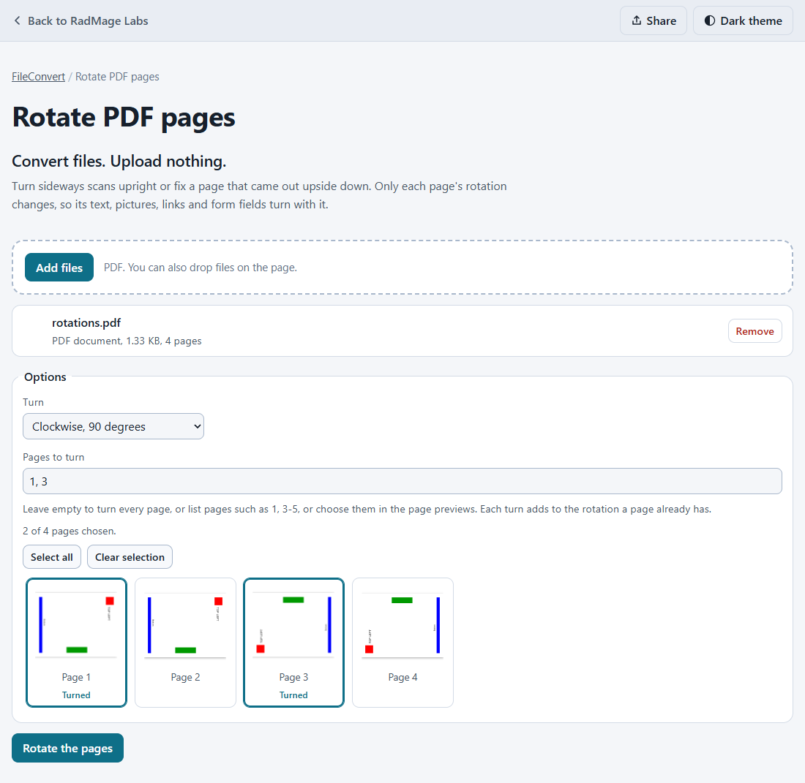

# FileConvert

**Convert files. Upload nothing. No accounts, no ads, no nonsense.**

FileConvert is a free file converter and toolkit that runs entirely in your browser: it converts images, audio, video, documents and data, compresses and resizes pictures, and merges, splits and edits PDFs. Your files are never uploaded, to me or to anyone else: everything happens on your own device.

39 formats, 216 conversions between them, and 16 tools, each with a page of its own (66 pages in all).

**Use it at [radmagelabs.com/fileconvert](https://radmagelabs.com/fileconvert/).**

Current version: **v0.2.0**


## What it does

| From | To |
|---|---|
| **Images:** JPG, PNG, WebP, AVIF, HEIC/HEIF, BMP, GIF, TIFF (every page), ICO/CUR, SVG | JPG, PNG, WebP, AVIF, GIF, BMP, TIFF (one page or multi-page), ICO |
| Animated GIF, WebP and PNG (APNG) | Animated GIF, animated WebP, MP4, WebM |
| **Audio:** MP3, WAV, FLAC, AAC, M4A, OGG (Vorbis or Opus), AIFF/AIFF-C | MP3, WAV, FLAC, AAC, M4A, OGG (Opus) |
| **Video:** MP4, WebM, MOV, MKV, MPEG-TS (.ts, .mts, .m2ts) | MP4, WebM, MOV, MKV, GIF, or any audio format above (the soundtrack) |
| **Documents:** TXT | PDF |
| PDF | TXT |
| Markdown | HTML, PDF, DOCX |
| HTML | PDF, Markdown, DOCX |
| DOCX | TXT, HTML, Markdown |
| **Data:** JSON | CSV, TSV, XLSX, JSON Lines, YAML, XML |
| JSON Lines | JSON, CSV, TSV, XLSX |
| CSV | JSON, TSV, XLSX, JSON Lines |
| TSV | JSON, CSV, XLSX, JSON Lines |
| YAML | JSON, CSV, TSV, XLSX |
| XML | JSON, CSV, TSV, XLSX |
| XLSX | CSV, TSV, JSON, JSON Lines |
| XLS, ODS | XLSX, CSV, TSV, JSON, JSON Lines |
| **Archives:** ZIP, TAR, GZ (.tar.gz, .tgz) | Unpacked, not converted: download the files inside, or convert them |

Every pair in this table is tested in the browser. Results are checked by reading them with independent programs (Pillow, FFmpeg, Xpdf's pdftotext, openpyxl, python-docx, LibreOffice, mistune, Python's csv and json), not by looking at file extensions.

**Extract files from a ZIP** and **Extract TAR, TAR.GZ and GZ files** have pages of their own; they are the same converter, which unpacks any archive you add. Several tools work on a set of files or on the pages of one PDF: **Remove photo metadata** takes camera details, dates, GPS location and other hidden data out of JPG, PNG and WebP photos without recompressing them, **Combine images into a TIFF** makes one multi-page TIFF from pictures in the order you choose, and **Merge PDFs** puts PDFs together in the order you choose. Merging copies every page as it is and keeps links, annotations, named destinations, form fields with their values, and layers; the bookmarks become one per file, named after it, with the file's own bookmarks under it. A form field whose name an earlier file already uses is renamed (name_2 in the second file), so each keeps its value. Accessibility tags, page labels, files attached to the document, document scripts, article threads and XFA form data are not carried, and the result lists what each file loses. A digitally signed PDF loses its signature's validity when it is merged, so FileConvert asks first. Each file in the list shows a small picture of its first page, drawn only for files near the screen; a file that cannot be drawn keeps a plain tile, and merging never waits for a picture.

**Images to PDF** (with pages of its own for JPG to PDF and PNG to PDF) makes one PDF from pictures in the order you set, one picture a page and every page of a multi-page TIFF: A4, US Letter or the size of each picture, portrait, landscape or automatic, with a margin, each picture fitted whole by default. JPEG pictures are copied into the PDF byte for byte, with no decoding and no new compression; PNG pictures go in with their own compressed data where PDF can hold it (gray, color or a palette at any bit depth, 16 bits included, one transparent color) and are otherwise decoded exactly and stored without loss, transparency kept as transparency. EXIF orientation is applied as the page is laid out, so no pixel is turned or resampled; color profiles become the color space of the picture, CMYK JPEGs stay CMYK, and photo metadata (EXIF with any GPS location, XMP, comments) is left out. HEIC, WebP, AVIF, GIF, BMP and TIFF are decoded once and stored without further loss. Pictures smaller than the page stay at their own size unless you choose to enlarge them, and filling the page, which cuts off edges, is an option; the result says how each picture went in and every change.

**Split a PDF** (by page ranges such as 1-3, 4-7, 8-, every few pages, or into single pages), **Extract pages from a PDF**, **Delete pages from a PDF**, **Reorder PDF pages** (drag the pages, move them with Up and Down, reverse them, or type the order) and **Rotate PDF pages** (a quarter turn either way, or upside down) work on one PDF. Split and extract make new PDFs that hold only their own pages: nothing of the other pages is copied, and links, bookmarks, named destinations and form fields stay only where their pages are. Delete removes pages and leaves nothing of them in the file; it is not redaction. Reorder keeps every link and bookmark pointing at the same page wherever it moves, and rotate changes only each page's rotation, so nothing is redrawn. Page lists are typed as 1-3, 7, 10- (10 to the end); a page listed twice, a range written backwards and a page that does not exist are refused with a message saying what to write instead. A new order may run backwards (10-4 is pages 10 down to 4), so every page in reverse is 5000-1; Reverse turns whatever order is set, on PDFs of any length up to the 5,000-page limit, and pressing it twice gives that order back. Ranges in a split may overlap, and each file gets its own copy of the pages. Every one of these tools checks a PDF as it is added, refuses encrypted and hostile files, and asks before changing a signed one.

These tools, and PDF to JPG and PNG, show **page previews**: small pictures of the pages to click (Shift-click for a run of pages, or the arrow keys and Space), with Select all and Clear selection; the typed page list and the previews follow each other, and typing stays the way to choose pages without a pointer. Reorder shows the pages as pictures to drag or move with Up and Down, rotate shows the chosen pages turned, and split labels each page with the file it goes to. Previews are drawn by pdf.js in a worker of their own, only for pages near the screen (at most 160 pictures are kept, and a canvas is let go when its page scrolls away), so a 5,000-page PDF stays light. A PDF too large to preview on the device shows numbered pages and the reason; no tool needs a preview to run.



**PDF to JPG** and **PDF to PNG** (one tool, with a page for each) save every page, or the pages you choose, as pictures at 72, 150 or 300 dpi or a resolution of your own from 10 to 1,200. Each page is drawn by pdf.js the way PDF readers show it, from its crop box and turned by its rotation, with comments, stamps and filled-in form fields. JPG pictures have a white background and the quality you choose (90 to start); PNG pictures are lossless, and their background can be transparent where the page paints nothing. The pixel size of the pictures is shown before you start, and nothing is drawn smaller to fit a limit: a page that would be more than 100 megapixels, or work that would need more memory than the browser can give, is refused with the size it would have and the resolution at which it fits. Pages are drawn one at a time, and each picture waits in the browser's private storage until you download it, one by one or as a ZIP; names carry the page number padded so they sort, such as report-p007.png.

**Remove PDF metadata** takes out the document information (title, author, subject, keywords, the app that made the PDF and the one that wrote it, creation and modification dates, custom fields), the XMP metadata of the document and of its pages, pictures and fonts, application data stored with pages (an editor's private copy of what it made), page thumbnails, web capture information, and EXIF, GPS, XMP, IPTC and comments inside JPEG pictures, whose picture data is not touched. The file is written whole, so earlier versions saved inside it and parts nothing uses do not survive, and it gets a new identifier made from its own bytes. Pages, comments, bookmarks, links, form fields and their values, attachments and layers are kept; the PDF's metadata is listed as it is added, and the result lists what was removed and which of the kept parts the PDF has, since those can name people too.

**Compress PNG**, **Compress JPG**, **Compress WebP**, **Compress AVIF** and **Resize images** make pictures smaller. Compress PNG is lossless: oxipng recompresses each file and may store it more compactly (a palette, gray, fewer bits) where no pixel changes, and every result is checked pixel by pixel, every frame of an animated PNG included, before it is offered. A color picture with an RGB color profile stays color, and 16-bit pictures stay 16-bit unless you allow 8 bits where every value fits. Compress JPG works three ways: lossless (the compressed picture written again with Huffman tables made for it, like jpegtran: a few percent smaller, every pixel the same in every viewer, checked), at a quality, or to a file size in KB or MB, where MozJPEG compresses the photo again and the quality is searched for the highest that fits; the dimensions are never changed to reach a size, and making the picture smaller is a separate option. Compress WebP is lossy at a quality or a size, or lossless with every pixel kept; Compress AVIF keeps 8, 10 or 12 bits per channel, HDR, transparency and the color profile. Resize images fits pictures within a width and height (the shape kept), makes them an exact size (stretched, only when chosen) or scales them by a percentage, never enlarges unless you allow it, turns each upright from its EXIF orientation, and saves in the same format or as JPG, PNG, WebP or AVIF; nothing is cropped. Metadata (EXIF, XMP, text, the color profile, and pictures after a JPG's main one, such as an HDR gain map) is kept unless you choose to remove it, and then the color profile and orientation stay. Each result says its size before and after, the bytes and the share saved, its dimensions, whether it is lossless or lossy, and what changed; a compression that would not make a file smaller gives back the original unchanged. SSIM, a similarity measure, can be shown for lossy results, and **Compare with the original** lays a lossy result over its original with a slider to move between them.


### What each kind of conversion does

- **Images:** quality for JPG, WebP and AVIF; resizing by percent or to fit inside a box (never enlarging); transparency kept where the output format can hold it and replaced by a background color you choose where it cannot (JPG, BMP), with a note saying so. EXIF orientation is applied to the pixels. Animated GIF, WebP and PNG stay animated as GIF, WebP, MP4 or WebM, with each frame's timing, the loop count, transparency and the source's disposal and blending rules; the output menu marks the formats that keep only the first frame. Every page of a multi-page TIFF converts, one file per page or one TIFF holding them all, and TIFF can be written with lossless LZW compression. ICO output is a favicon (16, 32 and 48 pixels), all six sizes up to 256, or one size. An SVG is drawn at its own size, two or four times larger, or a width you choose, after it has been cleaned (see Privacy and security).
- **Audio:** bitrate, sample rate and channels. Streams are copied without re-encoding when nothing asks for a change and the new container can hold them (an M4A to AAC, for example). Descriptive tags such as title and artist are kept.
- **Video:** resolution (2160p down to 360p, never enlarging), quality, and removing the sound. With quality set to Original, streams that fit the new container are copied, which is fast and lossless; MP4, MOV and MKV get H.264 video with AAC audio and WebM gets VP9 with Opus when re-encoding is needed. Video to GIF uses your choice of width and frame rate.
- **Documents:** PDFs are written with real, selectable text in Noto Sans and Noto Sans Mono. Plain text keeps its layout (monospaced, tabs expanded, long lines wrapped); Markdown and HTML keep their structure: headings, emphasis, lists, tables, code, block quotes, links and embedded PNG or JPEG pictures. PDF to TXT reads the text layer page by page. DOCX to TXT writes one line per paragraph, keeps line breaks, marks list items and puts table cells on one line separated by tabs.
- **Documents to and from Markdown and Word (v0.2.0):** these keep the structure, not the look. HTML and DOCX to Markdown write GitHub-flavored Markdown with headings, bold, italic, strikethrough, inline code, links, pictures, nested lists, tables with their alignment and escaped `|`, fenced code blocks (with the language when the HTML names it), block quotes and footnotes; subscript and superscript stay as HTML tags. DOCX to HTML is one standalone page with the same structure, underline included, that loads nothing from the web. Word, LibreOffice and pandoc quote and code styles, and text set in a code font such as Consolas, become quotes and code. Pictures stored in a DOCX stay inside the HTML or Markdown as data URLs. For Markdown, Documents settings can instead write them as separate files, in one ZIP holding the Markdown and an `assets` folder beside it (`assets/report-1.png`, names that need no escaping, the same picture used twice stored once, SVG pictures cleaned first), so the relative links work wherever it is extracted, a GitHub repository included; or replace each by its description. Markdown and HTML to DOCX write Word's own Heading, List Paragraph, Hyperlink and table styles, real nested Word lists, Code Block and Inline Code styles, and the PNG, JPEG, GIF and BMP pictures inside the file, on US Letter or A4 pages. From HTML, numbered lists keep their starting number, tables keep merged cells and tables inside cells, underline and highlighting are kept, and links within the page jump to the heading they name.
- **Data:** nested JSON becomes dotted CSV columns (`address.city`), with lists kept as JSON text or spread into numbered columns; CSV can rebuild the nesting. CSV delimiters are detected, text encodings (UTF-8, UTF-16, Windows-1252) are detected and reported, numbers are recognized without breaking leading zeros such as ZIP codes, and integers beyond 2^53 stay exact. XLSX to CSV or TSV lets you pick a worksheet or get one file per sheet, with values as Excel displays them or the underlying values. XLSX to JSON keeps numbers, true/false and empty cells as JSON values and writes dates as ISO 8601 text; JSON to XLSX writes typed cells, one sheet per list, and never a formula. XML attributes become `@` keys and element text `#text`, both ways.
- **More data (v0.2.0):** XLS (Excel 97-2003) and ODS workbooks convert like XLSX, and to XLSX with every sheet, value, formula with its saved result, number format, merged range and (XLS) column width and hidden sheet; cell formatting, charts, pictures, comments and macros are not kept, and the result says so. JSON Lines (`.jsonl`, `.ndjson`, or NDJSON saved as `.json`) is read strictly, one value per line: a line that is not valid stops the conversion and is named. XML and YAML convert to CSV, TSV and XLSX by the rules below.
- **Audio and video inputs added in v0.2.0:** AIFF and AIFF-C (8 to 32-bit, float, mu-law and A-law) and MPEG-TS. When a transport stream holds something the browser cannot convert, such as MPEG-2 video from a TV recording, it is named before converting instead of being dropped.
- **Archives:** a ZIP, TAR or GZ file gets **Extract files** instead of a list of outputs. Its files are listed with what each one is; download any of them, or select the ones that can be converted and add them to the list without choosing them again. Archives are never converted into another archive format.

Anything that is lost or changed on the way (transparency, animation frames, a color profile, a character the PDF font lacks, a formula without a saved result) is listed under the file in a short note. Nothing is dropped silently.

### How data becomes a table

- **JSON, JSON Lines and YAML:** a list gives one row per item (JSON Lines is always such a list). An object whose values are all lists gives one table per list. An object holding lists of records (lists of objects) beside other fields gives one table per such list, and the other fields are repeated on every row as extra columns, so nothing is lost. Any other object is one row. Several YAML documents are one row each, or one table of all their items when every document is a list.
- **Tables are never combined:** two lists of records give two tables (two CSV files, or two sheets), each with the surrounding fields repeated; no row is ever a combination of a record from one list and a record from another, since nothing says which goes with which. Rows come only from the top level: a list of records inside a record (an order's lines) or inside another field stays in its row, as JSON text or numbered columns, and the notes name it. A list that mixes records with other values is never used as the rows; it is kept whole in a field.
- **Nothing is left out:** every field of the source is a column or is inside one. When two fields would give the same column name (a key `a.b` beside a nested `a` with a `b`), the later one gets `_2`; a record field named like a surrounding field does the same. A key repeated within one JSON object cannot be kept (JSON allows one value per key, and every JSON reader uses the last one), so the notes say how many there were.
- **Empty values:** `null` and a missing field are empty cells; an empty list is written `[]` and an empty object `{}`, in both list settings. An empty list, an empty object or records with no fields give an empty file (or sheet) and a note, never blank lines; an empty list beside other lists keeps its own empty file or sheet.
- **XML:** the records are the elements that repeat. From the root, FileConvert steps into an element while it is the only child of its parent, and stops at the first element with a child name that occurs more than once; each repeated name there is one table. Attributes and child elements are columns by name (an attribute named like a child element keeps an `@`), deeper elements are dotted columns, and an element with attributes and text gives its text to its own column (`price`) and its attributes to `price.currency`. What sits beside the records, such as a `<meta>` block or an attribute of the element around them, is repeated on every row. Every value is text; Excel output can recognize plain numbers, with leading zeros kept as text.
- **In every row:** nested objects become dotted columns (`address.city`); lists become JSON text in one cell or numbered columns (`tags.0`), as chosen in Data settings; records with different fields share one column per field, a missing field being an empty cell; a list of lists gives rows without a header. Several tables give one CSV or TSV file each, or one sheet each in Excel, named after their lists, and the result's notes name every rule that was used and every choice the shape of the data left open.

## Using it

1. Drop files on the page, or press **Choose files**. Add as many as you like.
2. Each file is identified by its contents, not its name, and gets a list of outputs that make sense for it. **Set all to** changes many files at once.
3. Open a settings panel if you want to change quality, size, bitrate, page size or data options.
4. Press **Convert** on a file, or **Convert all**. Conversions run in the background with real progress where it can be measured, and each can be canceled.
5. Download each result, or **Download all (ZIP)**. Results with the same name are numbered (`photo.png`, `photo (2).png`) so nothing overwrites anything.

Common conversions also have their own page, such as `/fileconvert/heic-to-jpg/`: the same converter with that output chosen for every file you add, and a short guide to what happens to your files. **Find a conversion** searches all of them, and answers for conversions that have no page of their own.

Share copies the page's public address (for example `https://radmagelabs.com/fileconvert/`), or opens your device's share sheet. **Back to RadMage Labs** goes to the rest of my tools.

## Privacy and security

- **Files stay on your device.** There is no server that receives files. Every conversion runs in this browser tab, in background workers, and the page's Content Security Policy only allows connections back to the site itself (to load the app's own code, fonts and codecs). It cannot send anything anywhere else.
- **No accounts, no ads, no analytics.**
- **What the network is used for:** loading the page, and the first time you use each kind of conversion, loading that converter (for example the HEIC decoder, or the PDF fonts). Once loaded, it keeps working offline while the tab stays open.
- **Temporary storage:** audio and video results, and files unpacked from archives, are written to your browser's private storage for this site (the origin private file system) so large files do not have to fit in memory. They are deleted when you remove them from the list (an archive's files stay while a file taken from it is still in the list), clear the list, or close the tab; files left behind by a tab that crashed are deleted the next time the page opens. Pictures made by PDF to JPG and PNG wait there too, until the results change or the tab closes. In a private (Incognito) window the browser keeps this storage in memory instead of on disk, so very large results and archives use memory there. Other results are held in memory. Only your theme and settings are remembered between visits, in local storage.
- **Metadata is left behind.** Converted pictures carry no EXIF data (camera, date, GPS location); the compress and resize tools keep a picture's metadata unless you choose to remove it, since they are not conversions. Audio and video keep descriptive tags such as title and artist, but not other container metadata, such as a phone's recording location. To clean a photo without converting it, **Remove photo metadata** copies the picture data byte for byte and lists what it removed and kept; the picture itself can still show who or where it is. **Remove PDF metadata** does the same for a PDF's document information and XMP; it does not make a document anonymous, since names and other details can still be in its text, pictures, comments, attachments, form fields and digital signatures.
- **Files are treated as untrusted.** Detection reads the bytes, not the name, and warns when the extension is wrong. Images are checked for decompression bombs (a tiny file claiming billions of pixels) before decoding. DOCX and XLSX packages are inflated as a stream and counted before any library unpacks them, so ZIP bombs are refused even when their directory lies. XML with entity declarations (XXE, billion laughs) is refused, YAML alias bombs are refused, and nesting depth is limited. Markdown, HTML and the HTML read from a DOCX are sanitized with DOMPurify before use: scripts, event handlers, forms, frames and `javascript:` links are removed, nothing in a document is fetched, and macros and embedded objects in DOCX files are never run. A DOCX cannot choose its own HTML (a style map carried inside it is ignored), pictures it only links to are never fetched, and pictures from the web in Markdown or HTML stay addresses (Markdown) or become their description (DOCX, PDF). YAML tags such as `!!python/object` are never resolved, and XLS and ODS workbooks are checked before they are read (ZIP bombs in ODS, the file's own directory in XLS).
- **PDFs are checked before any PDF library reads them.** A guard in a background worker reads the file as bytes and decodes every compressed stream through its own filters as a count, in small pieces, so a file that would expand to gigabytes is measured without being held. It refuses a stream that expands past 256 MB, compressed data past 4 GB in all, object streams past 256 MB, pictures past 100 million pixels (in their dictionary and in the JPEG or JPEG 2000 header itself), oversized sampled functions and predictor rows, more than 500,000 objects or 5,000 pages, Brotli-compressed streams and encrypted files. It also follows forms the way pdf.js reads them, again each time one is drawn, with the soft masks, patterns and fonts written out in full that each uses, inside other forms and as an appearance that many annotations share, and refuses forms nested so often that no device could read them, or drawn in loops too tangled to follow. Measured on the previous build, such files made the browser use up to 4 GB and up to 28 seconds before failing; the guard refuses each within a second, and because it counts and discards rather than keeping what it decodes, the browser's memory rises by at most about 340 MB while it measures. Canceling stops the worker and frees its memory.
- **PDF pages are drawn in a worker of their own, after the same guard.** PDF to JPG and PNG and the page previews run pdf.js in a render worker, its parser included, and the guard reads every file there first, on the very bytes pdf.js gets. pdf.js draws fonts from their outlines (embedded fonts from the PDF, the standard ones from the font files it ships), and loads those fonts, its character maps, its JPEG 2000 and JBIG2 decoders and its CMYK color profile only from the app's own folder. PDF scripts are never run: the script engine pdf.js offers is not shipped. A preview that fails, or a browser that cannot draw in a worker, never stops a tool that does not need one.
- **Pictures for a PDF are checked whole as they are added**, in the PDF worker, without decoding them: a PNG's chunk checksums, and its compressed data inflated and read row by row (nothing kept) to see that it is complete; a JPEG's header and that its data reaches its end marker; every picture's size against the 100-megapixel and 30,000-pixel limits before anything is decoded. A damaged picture is refused with the reason. A PNG whose compressed data goes on past its picture (a small file can hold data that expands to gigabytes) is never expanded past the picture or copied into the PDF as it is: only its picture's rows are kept, compressed again without loss.
- **PDF work is refused before it starts when it would need more memory than the browser can give.** Editing a PDF or reading its text costs memory in proportion to what is in it, not only to its size: pictures cost a few times their bytes, while form fields, pages and other small objects cost far more than the bytes that describe them, and a PDF of a few kilobytes can describe millions of objects. In Chrome, a worker that runs out of memory makes the whole page stop responding, so FileConvert estimates what each task needs from what the guard has already counted (the file's size, the bytes read as objects, the pages, the largest stream, the page content and embedded fonts once decoded, how much content one page holds, padding included, and how much content and how many fonts forms make pdf.js read again, forms inside forms, soft masks, patterns and appearances that many annotations share included, on the 50 costliest pages it holds at once, and the soft masks the costliest page sets; for a split, what its new files would hold together, since each gets its own copy of the pictures and fonts its pages share) and refuses it first, saying how much it needs and how much is allowed. One task may use half of the memory the browser reports for the device, or, where the browser does not report it (Firefox, Safari), 2 GB on a computer and 1 GB on a phone or tablet; 4 GB at most. Chrome and Edge also report their JavaScript heap limit, which the estimate is held to as well. The estimate's figures were measured in Chrome, Firefox and WebKit, and the browsers that use more memory for the same work get the higher figures. They were then checked against files made for the purpose and not used to fit them; where those needed more, the figures were raised and checked again on further unseen files. The estimate is still a model fitted to measurements, not a guarantee: a file built unlike any measured one can need more. The WebKit figures come from WebKit as Playwright runs it on Windows, which is not Safari on a Mac, an iPhone or an iPad; Safari has not been measured. Images to PDF has its own estimate, from each picture's header before anything is decoded: what the PDF holds of every picture, plus the most that adding any one of them takes (its file, and its decoded pixels when it has to be decoded), plus its pages. PDF to JPG and PNG and the previews have one too: what pdf.js holds of the file, the largest picture in it decoded whole, and the largest page being drawn, with the canvases pdf.js adds for transparency and the encoder's copy; it is checked again before each page with the size pdf.js reports. Its figures were measured in Chrome and Firefox; WebKit as Playwright runs it cannot draw in a worker, so browsers not told apart get figures above both.
- **Pictures to compress or resize are checked as they are added**, in the image worker: a PNG whole (every chunk's checksum, its header, the end chunk), a JPEG's segments and its end marker, a WebP's chunks and an AVIF's boxes; animated WebP and AVIF, 12-bit and arithmetic-coded JPEG, and damaged files are refused with the reason before anything is decoded. Each picture's memory is estimated from its header (its size, pixels, bit depth and, for a lossless JPEG, how many coefficients it holds) and the work is refused before it starts when it would need more than the browser can give, on the same allowance as the PDF tools. The codecs (oxipng, MozJPEG, libwebp, libavif) are WebAssembly loaded from the app's own folder only when a tool needs them; the worker that handled a picture of 2 megapixels or more is let go after it, so the next picture starts with a new one rather than with what the browser has not yet freed.
- **SVG files are cleaned before they are drawn:** only drawing elements and attributes are kept; scripts, event handlers, HTML content, animation and every reference to a file, font or stylesheet outside the SVG are removed; SVGs that declare entities are refused. The cleaned drawing is then drawn as a picture, where browsers run nothing and fetch nothing.
- **Archives are unpacked with limits on what they actually hold,** not on what their headers claim: compressed data is fed in small pieces and counted, a file that unpacks to more than its listed size or expands more than 1000 times is stopped, and the number of files and the total size are capped. Paths are only shown, never used: `..`, absolute paths and drive letters are dropped and each download gets a safe, unique name. Links, devices, encrypted files and unsupported compression methods are listed, not unpacked; archives inside archives are unpacked only when you ask. Checksums are verified.
- **Spreadsheet formulas:** CSV results protect text cells that start with `=`, `+`, `-` or `@` with a leading apostrophe, so opening them in a spreadsheet cannot run a formula (you can turn this off). CSV to XLSX stores such cells as text, never as formulas.
- **File names** are reduced to safe names before they are used for downloads or inside a ZIP: no paths, no characters Windows forbids, no reserved names and no text-direction tricks.

To report a security problem, open an [issue](https://github.com/RadMageIRL/fileconvert/issues) without the details and ask for a private channel.

## Browsers

| Browser | Status |
|---|---|
| Chrome 157 and Edge 157 (Windows) | Everything above. The full test suite passes. |
| Firefox 157 (Windows) | Everything above, except HEVC (H.265) video input, which Firefox cannot decode. The full test suite passes. |
| Chrome on a phone-sized screen | The interface, conversions and tools tested at 412 pixels wide (Pixel 7 emulation), and every page checked at 390 and 320 pixels wide. |
| WebKit (the engine Safari uses, as Playwright builds it for Windows) | Conversions, the PDF tools, Images to PDF and the image tools pass their tests, except what needs drawing in the background (OffscreenCanvas in workers), which this build lacks: PDF to JPG and PNG, page previews, WebP pictures in Images to PDF, and CMYK JPEG, GIF and BMP in the image tools. Those say so instead of starting. This is not Safari. |
| Safari | Not verified: I have not tested it on a Mac, an iPhone or an iPad. Safari 16.4 and later has what FileConvert needs. Memory limits there are set conservatively, from the WebKit measurements and well above Chrome's and Firefox's. |

Which audio and video codecs work depends on the browser and the computer, because the browser's own encoders and decoders do the work (often on the graphics chip). FileConvert checks before converting and says when something is not available, rather than failing halfway. Browsers without OffscreenCanvas or WebCodecs get a clear message for the conversions they cannot do; data and document conversions still work there.

## Known limitations

- **HEIC is read but not written.** The open HEVC encoders are GPL-licensed and patent-encumbered, and none is practical in a browser.
- **AVI and WMA are not supported yet**, for reading or writing. RAR and 7-Zip archives are not supported.
- **DOCX to PDF and PDF to DOCX are not offered.** Page layout cannot be reproduced faithfully in a browser, and I would rather not offer a conversion that quietly rearranges a document.
- **Scanned PDFs need OCR** (optical character recognition), which FileConvert does not do. It says so when a PDF, or some of its pages, has no text layer.
- **Documents to and from Markdown, HTML and DOCX keep the structure, not the look.** Fonts, colors, sizes, alignment, page layout, headers and footers, comments and tracked changes are not carried over. Markdown has no underline, merged table cells are split, and numbered lists start at 1 whatever number a DOCX started them at. EMF and WMF drawings in a DOCX are kept but browsers cannot show them. Pictures kept inside Markdown as data URLs do not show on GitHub (choose separate files for that); pictures a document only links to, from the web or a relative address, are never downloaded, so they are not in the ZIP either. Task list boxes stay as text in DOCX. HTML to Markdown and HTML to DOCX convert the whole page body, menus and footers included, and apply none of the page's styles; WebP, AVIF and SVG pictures in HTML become their description in DOCX.
- **XLS and ODS to XLSX** keep values, formulas, number formats and merged cells, but not fonts, colors, borders, charts, pictures, comments or macros; ODS column widths and hidden sheets are not read either. Check the result before replacing the original.
- **Markdown and HTML to PDF** keep the document's structure in a clean default style. Stylesheets and page layout CSS are not applied, and pictures from the web are not downloaded (they become their description). Only PNG and JPEG pictures embedded in the file are included.
- **The PDF fonts cover Latin, Greek and Cyrillic.** Other scripts (Chinese, Japanese, Korean, Arabic, Hebrew, Hindi and others) are reported and do not show.
- **Animated AVIF** becomes its first frame, with a note. Animated WebP and APNG are read with the browser's ImageDecoder, which current Chrome, Edge and Firefox have.
- **SVG text** uses the fonts installed on your device; fonts an SVG links to on the web are not downloaded, and pictures it links to are left out (pictures embedded in the file are drawn).
- **Compressed AIFF-C** (such as IMA ADPCM) is refused with its codec named. In an MPEG-TS file, MPEG-2 video converts to its sound only, and sound in a private stream (AVCHD camcorders) is reported, not converted.
- **Images to PDF** decodes WebP, AVIF, GIF and BMP pictures in the browser, which gives sRGB colors and, for partly transparent pixels, colors that can be off by a small amount (the browser's canvas stores them premultiplied); 16-bit TIFF and high bit depth AVIF and HEIC become 8 bits per channel; the result names each picture this happens to. A PNG gamma setting without a color profile is not applied. Animated pictures give their first frame. A JPEG cut off before its end is refused. The PDF has no text layer (no OCR) and no accessibility tags. Browsers without OffscreenCanvas in workers (Playwright's WebKit on Windows, Safari before 16.4) cannot decode WebP, GIF and BMP pictures for it, and say so as they are added; JPEG, PNG, TIFF, HEIC and AVIF work there.
- **PDF to JPG and PNG** draws with pdf.js, the PDF reader built into Firefox, which can differ from other readers in small ways. Fonts a PDF names without including are drawn with standard fonts (Arimo, which has Arial's widths, for Helvetica and Arial; pdf.js's Foxit fonts for Times and Courier), and for other scripts, such as Chinese, Japanese and Korean, with the device's own fonts, so such text can look a little different and a character the device's fonts lack can show as a box (Firefox did so for one Japanese character in a test). Transfer functions (rare, from print workflows) are not applied, and XFA-only forms show their fallback page. Needs OffscreenCanvas in workers (current Chrome, Edge, Firefox, Safari 16.4 and later); Playwright's WebKit on Windows has none and says so. One picture is at most 100 megapixels and 32,767 pixels a side, 4,096 x 4,096 on a phone or tablet whose browser does not report its memory (Safari draws no larger canvas there).
- **Page previews**, and the first-page pictures in Merge PDFs, need the same, and show numbered pages or plain tiles without pictures where they are not available or a PDF is too large to preview on the device. Where a browser cannot draw in the background, PDF to JPG and PNG says so as soon as its page opens, and the catalog marks it, instead of taking a file first.
- **Remove PDF metadata** keeps everything that is part of the document: comments with their authors and dates, attachments with their names and dates, form values, bookmarks, digital signatures with the signer's name and certificate, and anything written on the pages or hidden behind other content. Metadata inside JPEG 2000 pictures, and in JPEG pictures stored with another compression on top, is not removed (the result says when the latter happens). A PDF/A or PDF/UA file no longer conforms after its XMP is removed, and a signed PDF's signature is no longer valid.
- **Compressing a JPG at a quality or to a size loses a little detail each time**; keep the originals. Lossless avoids that with smaller savings. CMYK photos become RGB when compressed at a quality or resized, decoded by the browser with their profile, which needs OffscreenCanvas in workers (so does Resize images for GIF and BMP). Arithmetic-coded, 12-bit, lossless and hierarchical JPEGs are refused. A lossless result has no restart markers, and a progressive one uses libjpeg's standard scan script.
- **Compress PNG** removes interlacing (smaller files; the picture no longer appears gradually while it loads) and can drop the significant-bits (sBIT) and background-color (bKGD) suggestions when it stores a picture in another color type; the result says so. Savings depend on how a file was saved: files an optimizer already went through may not shrink.
- **Compress AVIF** does not write EXIF or XMP into its results (the result says when a file had them), searches a size only for pictures up to 16 megapixels since each try is a full AVIF encode, and is slow in a browser. Lossless AVIF keeps every pixel only for some pictures, as AVIF stores colors as YUV; when it cannot, it says so and changes nothing. Animated WebP and AVIF are refused rather than reduced to one frame, and so are animated GIF, WebP and PNG in Resize images.
- **Resize images** keeps EXIF (with its orientation set to 1, as the pixels are turned upright), XMP and the color profile in JPG, PNG and WebP results, and the color profile only in AVIF results. A PNG's text fields stay only in a PNG result and a JPG's comment only in a JPG result, and the pictures after a JPG's main one (an HDR gain map, a motion photo) are not kept; each result lists what it kept and says what it could not.
- **Color profiles:** the browser applies the color profile of the pictures it decodes (JPG, PNG, WebP, AVIF, GIF, BMP). HEIC and TIFF color profiles are not applied, so wide-gamut photos can look slightly less vivid.
- **GIF output** holds 256 colors per frame without dithering, so photos and gradients can show banding. Video to GIF is limited to 900 frames.
- **HDR video** that is re-encoded is not tone-mapped and can look washed out.
- **CSV has no types:** with number detection on, a digit string without leading zeros (such as `10001`) becomes a number; turn detection off to keep everything as text.
- **PDF limits.** A PDF is refused, with the limit it passed named, when one compressed stream expands past 256 MB, all of them past 4 GB, one picture has more than 100 million pixels, or the file has more than 500,000 objects or 5,000 pages, or its forms are drawn inside one another too often or in ways too tangled to measure. Nothing is shrunk or left out to make a file fit. Very large high-resolution scans can pass these limits: a 600 dpi A2 color scan is one picture of about 139 million pixels (418 MB uncompressed), so a PDF holding one is refused however it is compressed; the same page scanned at 300 dpi (35 million pixels) opens. Checking a file at the limit can briefly raise the browser's memory by about 340 MB (measured; it is not a ceiling). Merge PDFs takes up to 200 files, 5,000 pages and 1 GB together.
- **PDF memory.** Every PDF tool and PDF to TXT is held to the memory check described under Security, so how large a PDF can be edited depends on the device and the browser: on a computer whose browser reports 8 GB, about 850 MB of pictures in one task; where the browser reports nothing, about a quarter of that or less. A PDF that is refused is refused whole; nothing is shrunk or left out to make it fit. The check errs on the side of refusing: in the last check, of forms drawn inside forms, soft masks and fonts written out in forms, 208 measurements in Chrome, Firefox and WebKit on files made for it, one peak was 1% above its estimate (in one of two runs of the same file), and many estimates were several times above their peaks.
- **Size limits** keep the browser from running out of memory: pictures up to 100 megapixels and 300 MB (up to 500 of them and 5,000 pages in one PDF from Images to PDF), audio and video up to 8 GB, PDFs up to 500 MB, text to PDF up to 8 MB, data files up to 200 MB, SVG files up to 20 MB, archives up to 10,000 files and 4 GB unpacked (1 GB where the browser has no private file storage), a combined TIFF up to 1,000 pages, and the batch ZIP up to about 4 GB.

## Development

FileConvert is a static site built with Vite and TypeScript. Conversions run in Web Workers; nothing needs a server.

Requirements: Node.js 24. The browser tests also use FFmpeg and Xpdf's `pdftotext` on the path, Python 3 with Pillow 11.3 or later, pillow-heif, NumPy and openpyxl (set `FILECONVERT_PYTHON` to that Python), Google Chrome, Microsoft Edge, and Playwright's Firefox and WebKit.

```
npm ci
npm run dev            # development server at http://localhost:5173/
npm run build          # type check and production build into dist/
npm test               # unit tests (Vitest)
npm run test:e2e       # browser tests against dist/: Chrome, Firefox, Edge, WebKit and a phone-sized Chrome
npm run test:large     # large files: a 48-megapixel photo, a 1 GB video, a 50 MB CSV
npm run notices        # rewrite THIRD-PARTY-NOTICES.txt after a dependency change
npm run release        # build twice, check the builds match, and pack release/ with SHA-256 sums
npm run fixtures       # regenerate the test files in tests/fixtures/
```

`node tools/serve.mjs` serves `dist/` at `http://127.0.0.1:4175/fileconvert/` with the same security headers radmagelabs.com sends; `--pages` serves it without headers, like GitHub Pages. Like both hosts, it redirects a page address without its trailing slash and answers unknown addresses with `404.html`. Setting `FILECONVERT_BASE` (for example to `https://radmagelabs.com/fileconvert/`) runs the browser tests against a live copy instead. The test files in `tests/fixtures/` are synthetic (gradients, test patterns, sine tones and placeholder text) and are made by `tools/make-fixtures.py` and `tools/make-pdf-fixtures.mjs`.

The release download is the built site. Serve it from any web server (for example `python -m http.server` in its folder); browsers do not run module workers from pages opened as local files.

Layout:

- `src/core/`: the format registry, the list of dedicated pages (`pages.ts`), content sniffing, safe names, limits, text decoding, the ZIP check and temporary storage.
- `src/site/`: the build step that renders the pages. Every page comes from the built `index.html`, so all of them share its scripts, styles and security policy; the build also writes `sitemap.xml` and `404.html`, and fails if a page names a conversion FileConvert does not perform.
- `src/engines/`: one folder per kind of conversion (image, media, document, data).
- `src/workers/`: the Web Workers that run the engines.
- `src/app/`: the queue, the worker pools, the interface, the catalog search, and the workspace that multi-file tools run in.
- `tests/unit/` and `tests/e2e/`: Vitest and Playwright tests.

## License

FileConvert is MIT licensed; see [LICENSE](LICENSE). It is built on open-source libraries, listed with their licenses in [THIRD-PARTY-NOTICES.txt](THIRD-PARTY-NOTICES.txt), which also ships with the app. Most are permissive; Mediabunny (MPL-2.0) and the LGPL codecs it and libheif-js include (LAME, FFmpeg's AAC encoder, libheif, libde265) are shipped as separate files, unmodified, with links to their source.
